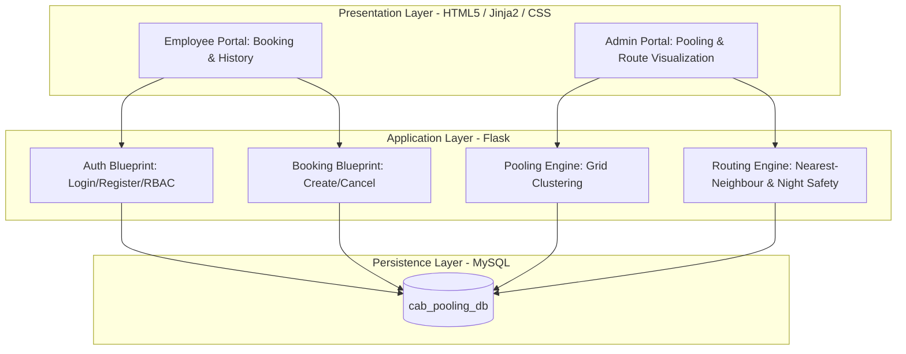
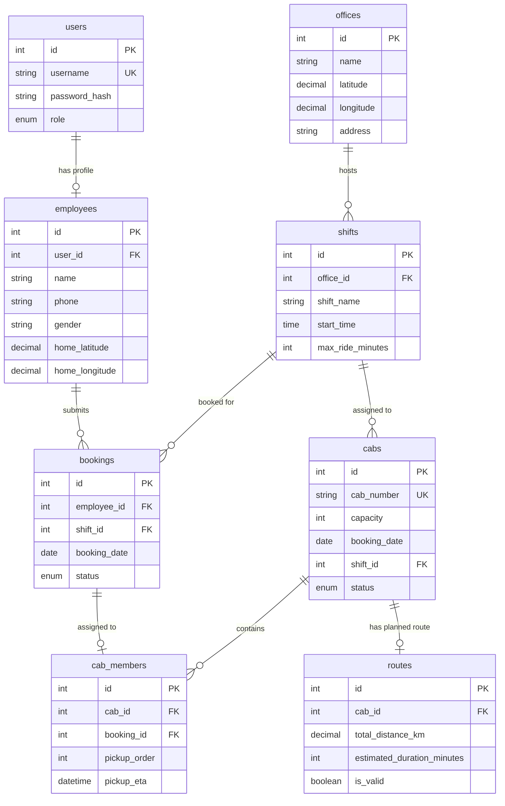

# 🚕 Cab Pooling & Smart Pickup Routing System

A production-ready Flask + MySQL employee transportation management system that intelligently groups commuting employees into shared cabs and generates optimized pickup routes while strictly adhering to **cab capacity limits, maximum ride-time thresholds, and night-shift safety policies**.

---

## 📑 Table of Contents

- [Overview](#-overview)
- [System Architecture](#-system-architecture)
- [Key Features](#-key-features)
- [Tech Stack](#-tech-stack)
- [Project Directory Structure](#-project-directory-structure)
- [Database Architecture](#-database-architecture)
- [Algorithms & Heuristics](#-algorithms--heuristics)
  - [1. Geographic Grid Pooling](#1-geographic-grid-pooling)
  - [2. Nearest-Neighbour Pickup Routing](#2-nearest-neighbour-pickup-routing)
  - [3. Night Safety & Escort Validation](#3-night-safety--escort-validation)
  - [4. Dynamic Late-Booking & Cancellation Re-planning](#4-dynamic-late-booking--cancellation-re-planning)
- [Setup & Installation](#-setup--installation)
- [Default Demo Credentials & Seed Data](#-default-demo-credentials--seed-data)
- [Application Routes](#-application-routes)
- [Running Unit Tests](#-running-unit-tests)
- [Complexity Analysis](#-complexity-analysis)
- [Roadmap & Enhancements](#-roadmap--enhancements)

---

## 🌟 Overview

Corporate employee transport faces three major challenges:
1. **High Fleet Costs**: Sub-optimal seat utilization and inefficient routing lead to excess cabs.
2. **Long Commute Fatigue**: Employees spending excessive time in transit due to zig-zag routing.
3. **Safety & Compliance**: Stringent night-shift safety regulations requiring that lone female employees are not picked up first or dropped off last without security escort.

This system provides a practical backend heuristic and interactive web portal to automate shift-wise employee grouping, compute pickup sequences with realistic ETAs, enforce ride-time limits, and handle dynamic route changes (late bookings and cancellations) in real-time.

---

## 🏛️ System Architecture



---

## ✨ Key Features

### 👤 Role-Based Portals
- **Employee Portal**:
  - Register with GPS coordinates (home location) and gender.
  - Book cabs for designated shifts and dates.
  - View booking status and pickup schedule.
  - Cancel existing active bookings.
- **Admin Portal**:
  - View all shift bookings and active pools.
  - One-click automated cab grouping based on configurable capacity (default: 4 passengers).
  - Detailed route inspection showing pickup sequence, per-employee ETA, total trip duration, and distance.
  - Dynamic late-booking insertion into existing cabs without perturbing unaffected routes.

### 🧠 Smart Pooling & Routing Heuristics
- **Geographic Grid Partitioning**: Divides coordinates into discrete spatial grid cells to avoid comparing all pairs of employees.
- **Nearest-Neighbour TSP Heuristic**: Begins from the employee farthest from the office and sequentially visits the closest employee, ensuring intuitive, monotonic directional flow towards the destination.
- **Strict Ride-Time Constraints**: Validates that no employee exceeds the maximum permissible travel window configured for their shift.
- **Night-Shift Women Safety Compliance (22:00 - 06:00)**:
  - Detects if a solo female passenger is routed as first pickup or last drop.
  - Automatically re-evaluates permutation orders to find a compliant route.
  - Triggers escort / security guard flag if no compliant ordering is mathematically possible.
- **Zero-Waste Re-planning**:
  - Late bookings are fitted into existing cabs with spare capacity only if ride time and safety constraints remain satisfied.
  - Cancellations remove the member and recalculate solely the affected cab's route.

---

## 🛠️ Tech Stack

| Layer | Technology |
|---|---|
| **Backend Framework** | Python 3.10+ / Flask |
| **Database** | MySQL 8.0+ |
| **Database Driver** | `mysql-connector-python` |
| **Authentication & Security** | Werkzeug Security (`generate_password_hash`, `check_password_hash`) |
| **Environment Config** | `python-dotenv` |
| **Templating & UI** | Jinja2 templates, Vanilla Modern CSS |
| **Testing** | Python `unittest` suite |

---

## 📁 Project Directory Structure

```text
Cab-Pooling/
├── app.py                      # Flask application factory and blueprint registrations
├── config.py                   # Centralized environment variable loader & DB configuration
├── database.py                 # MySQL database connection helper
├── create_admin.py             # CLI script to bootstrap the administrator account
├── requirements.txt            # Python dependencies
├── .gitignore                  # Git ignore rules (venv, .env, __pycache__, etc.)
├── README.md                   # Project documentation
│
├── routes/                     # Blueprint route handlers
│   ├── auth.py                 # Registration, login, logout, session management
│   ├── admin.py                # Admin dashboard view
│   ├── employee.py             # Employee dashboard view
│   ├── booking.py              # Cab booking and cancellation endpoints
│   └── pooling.py              # Pool generation, route computation, late booking handler
│
├── services/                   # Business logic and algorithms
│   ├── pooling.py              # Spatial grid calculation, Haversine formula, cab grouping
│   └── routing.py              # Nearest-neighbour route builder, ETA & night safety validation
│
├── sql/                        # Database schemas and fixtures
│   ├── database.sql            # Table definitions, foreign keys, and indexes
│   └── seed.sql                # 25 demo employees, 2 offices, 3 shifts, and initial bookings
│
├── static/
│   └── css/
│       └── style.css           # Modern stylesheet with clean aesthetics and responsive layouts
│
├── templates/                  # Jinja2 HTML templates
│   ├── home.html               # Landing page with portal navigation
│   ├── login.html              # Login interface
│   ├── register.html           # Employee registration with coordinate inputs
│   ├── employee_dashboard.html # Employee landing dashboard
│   ├── book_cab.html           # Shift-based booking form
│   ├── my_bookings.html        # Booking history and cancellation action
│   ├── admin_dashboard.html    # Admin management panel
│   ├── generate_pool.html      # Shift selection & capacity configuration for pooling
│   ├── cab_pools.html          # Active cab pools overview
│   └── route.html              # Interactive pickup sequence, ETAs, and safety badges
│
└── tests/                      # Automated unit test suite
    ├── test_pooling.py         # Grid, Haversine, capacity, and edge case tests
    └── test_routing.py         # Route calculation, duration, safety & re-planning tests
```

---

## 🗄️ Database Architecture

The schema maintains referential integrity through foreign keys and cascading rules:



---

## 🧮 Algorithms & Heuristics

### 1. Geographic Grid Pooling
To avoid pairwise quadratic $O(n^2)$ comparisons across the entire city:
1. Employee coordinates $(\text{lat}, \text{lon})$ are mapped to spatial grid cells with a resolution of $\approx 0.02^\circ$ ($\sim 2\text{ km}$).
2. Cabs are formed by grouping employees residing in identical or immediately adjacent grid buckets.
3. If an employee cannot fill an existing cluster, unassigned pools are merged based on minimal Haversine distance:
$$d = 2R \arcsin\left(\sqrt{\sin^2\left(\frac{\Delta \text{lat}}{2}\right) + \cos(\text{lat}_1)\cos(\text{lat}_2)\sin^2\left(\frac{\Delta \text{lon}}{2}\right)}\right)$$

### 2. Nearest-Neighbour Pickup Routing
Finding the true optimal TSP order is $O(k!)$ (NP-hard). With small cab sizes ($k \in [4, 6]$), a greedy nearest-neighbour heuristic delivers optimal or near-optimal routes in $O(k^2)$ time:
1. Identify the passenger located **furthest** from the office destination to initiate the route.
2. Step iteratively to the **closest unvisited passenger**.
3. Complete the final leg from the last passenger to the office.
4. Convert road distance to minutes using calibrated city speed metrics ($\approx 30\text{ km/h} \Rightarrow 2\text{ min/km}$) plus a fixed boarding stop delay ($2\text{ min/stop}$).

### 3. Night Safety & Escort Validation
- **Night Window**: Shifts starting or ending between **22:00 and 06:00**.
- **Rule**: A female passenger cannot be the sole occupant during the initial pickup or final drop.
- **Heuristic**:
  1. Inspect the candidate route generated by the nearest-neighbour algorithm.
  2. If a safety violation is detected, iterate through alternative passenger permutations $O(k!)$ to locate a valid sequence that satisfies maximum ride time.
  3. If no ordering satisfies safety without exceeding the shift's `max_ride_minutes`, mark the route as `requires_guard = True` to mandate an escort guard.

### 4. Dynamic Late-Booking & Cancellation Re-planning
- **Late Booking**:
  - Scans active cabs with available seats (`len(members) < capacity`).
  - Simulates the route with the new passenger included.
  - Accepts the insertion only if all passengers remain within `max_ride_minutes` and night safety is preserved.
  - Updates only the modified cab in the database.
- **Cancellation**:
  - Frees the passenger's seat and deletes the `cab_members` reference.
  - If the cab is now empty, sets status to `CANCELLED`.
  - If passengers remain, triggers an immediate re-route of that individual cab to update ETAs.

---

## ⚙️ Setup & Installation

### Prerequisites
- **Python 3.10+**
- **MySQL Server 8.0+** running locally or remotely (e.g., Railway, AWS RDS)
- Git

### 1. Clone the Repository
```bash
git clone <your-repository-url>
cd Cab-Pooling
```

### 2. Create and Activate Virtual Environment

**Windows (PowerShell):**
```powershell
python -m venv .venv
.venv\Scripts\Activate.ps1
```

**macOS / Linux:**
```bash
python3 -m venv .venv
source .venv/bin/activate
```

### 3. Install Dependencies
```bash
pip install -r requirements.txt
```

### 4. Setup MySQL Database
Log in to MySQL and initialize the schema and demo seed data:

```bash
mysql -u root -p < sql/database.sql
mysql -u root -p < sql/seed.sql
```

*(Optional)* If using a custom database name, ensure `database.sql` and `seed.sql` match your schema name.

### 5. Configure Environment Variables
Create a `.env` file in the project root:

```env
SECRET_KEY=dev-secret-key-change-in-production
DB_HOST=localhost
DB_PORT=3306
DB_USER=root
DB_PASSWORD=your_mysql_password
DB_NAME=cab_pooling_db
PORT=5000
```

> ⚠️ Never commit `.env` containing sensitive credentials to GitHub.

### 6. Create the Admin User
Bootstrap the initial administrative account:

```bash
python create_admin.py
```
*Output:*
```text
Admin created successfully.
Username: admin
Password: admin123
```

### 7. Run the Application
```bash
python app.py
```

Access the portal in your browser:
```text
http://127.0.0.1:5000
```

---

## 🔑 Default Demo Credentials & Seed Data

The database seed (`sql/seed.sql`) provisions **25 demo employees**, **2 corporate offices**, and **3 shifts**:

| Role | Username | Password | Notes |
|---|---|---|---|
| **Admin** | `admin` | `admin123` | Full access to cab generation and route views |
| **Employee (Morning Shift)** | `demo01` to `demo10` | `demo123` | Active bookings for Gurugram Tech Park (09:00) |
| **Employee (Evening Shift)** | `demo11` to `demo14` | `demo123` | Active bookings for Gurugram Tech Park (14:00) |
| **Employee (Night Shift)** | `demo19` to `demo22` | `demo123` | Active bookings for Cyber City Office (23:00) |
| **Unbooked Employees** | `demo15` to `demo18`, `demo23` to `demo25` | `demo123` | Ready for testing late bookings & manual booking |

---

## 🌐 Application Routes

| Method | Endpoint | Access | Description |
|---|---|---|---|
| `GET` | `/` | Public | Home landing page with navigation links |
| `GET`, `POST` | `/register` | Public | Employee registration form |
| `GET`, `POST` | `/login` | Public | User authentication (Admin / Employee) |
| `GET` | `/logout` | Authenticated | Clears user session |
| `GET` | `/employee/dashboard` | Employee | Employee control center |
| `GET`, `POST` | `/booking/book` | Employee | Book cab for upcoming shift |
| `GET` | `/booking/my-bookings` | Employee | View active and historical bookings |
| `POST` | `/booking/cancel/<id>` | Employee | Cancel an active employee booking |
| `GET` | `/admin/dashboard` | Admin | Administrative summary and quick actions |
| `GET`, `POST` | `/pooling/generate` | Admin | Trigger cab clustering for a date & shift |
| `GET` | `/pooling/view` | Admin | List of all generated cabs and passenger lists |
| `GET` | `/pooling/route/<cab_id>`| Admin | Detailed pickup sequence, map stats, and ETAs |
| `POST` | `/pooling/cancel/<booking_id>` | Admin | Cancel booking and auto-recalculate cab route |
| `POST` | `/pooling/late-booking/<id>` | Admin | Auto-fit an unassigned booking into a viable cab |

---

## 🧪 Running Unit Tests

Comprehensive unit tests validate clustering, geometric formulas, route generation, ride time validation, and safety logic.

Execute the test suite using:

```powershell
python -m unittest discover -s tests -v
```

### Covered Test Cases:
- `test_grid_cell`: Spatial coordinates correctly hashed to grid identifiers.
- `test_distance`: Haversine formula distance verification.
- `test_cab_capacity`: Ensures no generated pool exceeds maximum vehicle capacity.
- `test_all_employees_assigned`: Confirms zero passenger drops during clustering.
- `test_empty_input`: Handles boundary cases without unhandled exceptions.
- `test_route_generation`: Verifies complete tour generation ending at office.
- `test_max_ride_time`: Confirms rejection of sequences that exceed travel budgets.
- `test_night_safety`: Validates compliance with night-shift escort and ordering rules.

---

## 📊 Complexity Summary

| Component | Time Complexity | Space Complexity | Description |
|---|---|---|---|
| **Spatial Grid Pooling** | $\mathcal{O}(n + m)$ | $\mathcal{O}(n)$ | Hash-map grouping where $m$ is candidate neighbor checks |
| **Route Generation (NN)** | $\mathcal{O}(k^2)$ | $\mathcal{O}(k)$ | Nearest-neighbour search for $k$ passengers per cab ($k \le 6$) |
| **Ride-Time Validation** | $\mathcal{O}(k)$ | $\mathcal{O}(1)$ | Linear check of cumulative travel duration per stop |
| **Night Safety Permutations**| $\mathcal{O}(k!)$ worst-case | $\mathcal{O}(k)$ | Bounded permutation fallback (for $k=4$, $4! = 24$ ops) |

---

## 🚀 Roadmap & Enhancements

- [ ] **OpenStreetMap / Google Maps API Integration**: Replace straight-line Haversine estimates with live traffic and turn-by-turn road networks.
- [ ] **Real-Time GPS Tracking**: Driver location tracking with dynamic ETA push notifications.
- [ ] **Automated SMS & WhatsApp Alerts**: Notify employees when their cab is approaching.
- [ ] **Driver Assignment Portal**: Mobile-responsive view for assigned drivers with turn-by-turn stop order.
- [ ] **Redis / Celery Background Tasks**: Offload large-scale daily pool generation to asynchronous worker queues.

